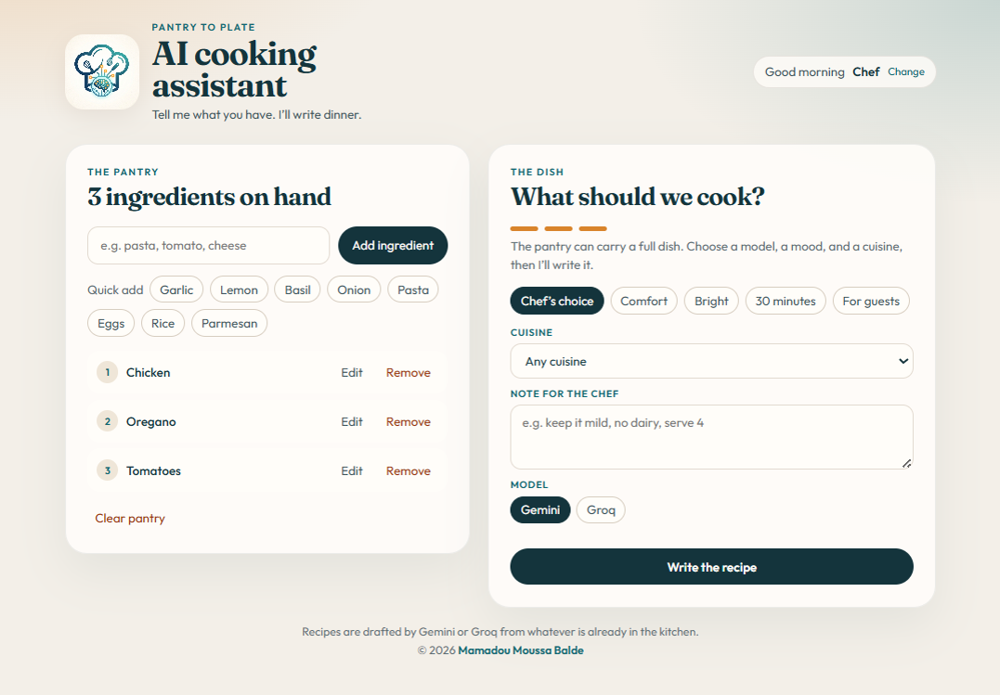
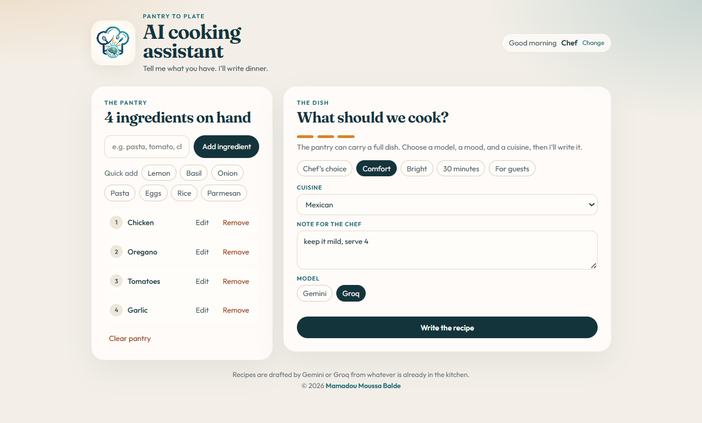
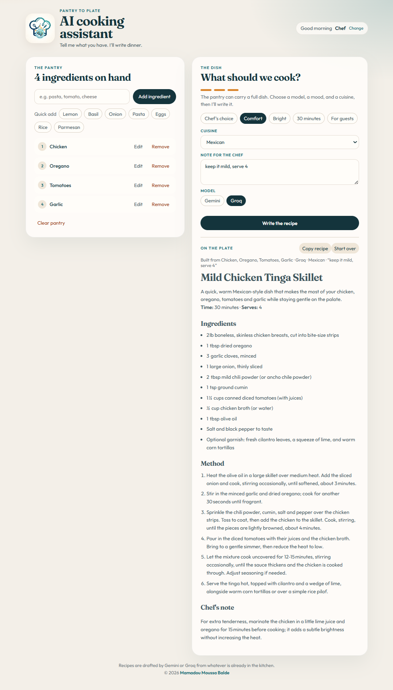

# AI cooking assistant

A Vite React page that drafts a recipe from the ingredients already on the counter.

## Description

The tab title is **AI cooking assistant**. The eyebrow is "Pantry to plate". The heading is "AI cooking assistant" and the line under it is "Tell me what you have. I’ll write dinner." Headings use Fraunces. Body text uses Outfit. The heading is 43.2px, color `rgb(20, 52, 60)`. The page background is `rgb(243, 239, 232)`.

The greeting follows the hour. This morning it read **Good morning**, then the name **Chef**, then **Change**. The name is stored under `chef-gemini-guest`. An empty name falls back to Chef, and the saved name is trimmed to 24 characters.

The pantry starts with 1 lb Chicken, 1 tsp Oregano, and 2 Tomatoes. The heading was "3 ingredients on hand". The add form has a quantity box (placeholder "2 cups") and an ingredient box (placeholder "e.g. pasta, tomato, cheese"). A blank quantity is allowed. Quick add offers Garlic, Lemon, Basil, Onion, Pasta, Eggs, Rice, and Parmesan, each with a stored amount, and hides a name that is already on the list. Each row shows the quantity, then the name. Edit changes both.



An empty Add click said "Type an ingredient first." Typing `chicken` and clicking Add said "chicken is already in the pantry." Clicking Garlic changed the heading to "4 ingredients on hand", added Garlic to the numbered list, and said "Garlic added." Garlic left the quick-add row. Each row has Edit and Remove. The bottom of the pantry panel has **Clear pantry**.

The second panel is "What should we cook?" With three ingredients the lead is "The pantry can carry a full dish. Choose a model, a mood, and a cuisine, then I’ll write it." Moods are Chef’s choice, Comfort, Bright, 30 minutes, and For guests. Chef’s choice starts pressed. Cuisines are Any cuisine, African, Mexican, Italian, French, Chinese, Indian, Japanese, Thai, Mediterranean, Middle Eastern, Caribbean, Korean, Spanish, and American. The note placeholder is "e.g. keep it mild, no dairy, serve 4". Under the note, **Model** offers **Gemini** and **Groq**. Gemini starts pressed.



The button reads **Write the recipe**. While it writes, the button says "Writing the recipe…" and the status line reads "Reading the pantry". The mood buttons, cuisine menu, note, and model buttons are disabled during that time. Gemini calls `gemini-2.5-flash`. Groq uses `groq-sdk` and `groq.chat.completions.create` with the model in `VITE_LLM`.

This run set Comfort, Mexican, the note `keep it mild, serve 4`, and Groq. The reply is **Mild Mexican Chicken Tomato Skillet**. The line under the toolbar is `Built from Chicken, Oregano, Tomatoes, Garlic · Groq · Mexican · “keep it mild, serve 4”`. The opening sentence is "A warm, comforting Mexican-style skillet that makes perfect use of your chicken, oregano, tomatoes and garlic while staying gentle on the heat." It lists **Time:** 25 minutes and **Serves:** 4, then Ingredients, Method, and a Chef's note. The toolbar says ON THE PLATE, **Copy recipe**, and **Start over**. The recipe is written under the dish form.



The footer says "Recipes are drafted by Gemini or Groq from whatever is already in the kitchen." This run showed © 2026.

| | |
| --- | --- |
| Deployment | [https://ai-cooking-assistant-c393.onrender.com/](https://ai-cooking-assistant-c393.onrender.com/) |
| Date | October 15, 2026 |
| Release | `67ca9f9` on `main` |

That release is the copy on Render now. It does not include the model switch yet.

## Getting Started

### Dependencies

* Node.js and npm. This run used Vite 7.0.6.
* A Gemini key from [Google AI Studio](https://aistudio.google.com/app/apikey), saved as `VITE_GEMINI_API_KEY`.
* A Groq key from [console.groq.com/keys](https://console.groq.com/keys), saved as `VITE_GROQ_API_KEY`.
* `VITE_LLM` set to the Groq model, `openai/gpt-oss-120b`.
* `.npmrc` sets `legacy-peer-deps=true` because `react@19.0.0-rc-8b08e99e-20240713` does not satisfy the `react-markdown` peer range.

### Installing

* Clone the repo and open this folder.
* Run `npm install`.
* Copy `.env.example` to `.env` and replace the placeholders. `.env.example` lists `VITE_GEMINI_API_KEY`, `VITE_GROQ_API_KEY`, and `VITE_LLM`.
* Vite only sends names that start with `VITE_` into the page, so restart the app after those values change.

### Executing program

From this folder, `npm start` and `npm run dev` both run Vite. This run opened http://localhost:5173/.

```
npm install
npm start
```

`npm run build` writes the static site to `dist`. `npm run preview` serves that build. On Render the site is a Static Site: build command `npm install && npm run build`, publish directory `dist`.

## Help

A recipe needs at least three ingredients. An empty add says "Type an ingredient first." A duplicate uses the typed string, as in "chicken is already in the pantry."

If the page says the key is missing, the matching `VITE_` name is empty or the dev server was not restarted after `.env` changed. On Render those values are baked in at build time, so a key change needs a new deploy.

`npm install` can fail with `ERESOLVE` on the React 19 release candidate and `react-markdown`. This folder’s `.npmrc` sets `legacy-peer-deps=true`. On Render, set `NPM_CONFIG_LEGACY_PEER_DEPS=true` as well, because Render’s install runs before the build command.

A Gemini reply of "This model is currently experiencing high demand" means the request reached Google and the model returned 503. That is not a missing key.

`@google/generative-ai` is the Gemini client. `groq-sdk` is the Groq client. `@anthropic-ai/sdk` and `@huggingface/inference` are installed, and this page does not call them. Technical notes are in `documentation.md`.

## Authors

[Mamadou Moussa Balde](https://www.linkedin.com/in/2mb/)

## Version History

* October 15, 2026
  * Live Render release `67ca9f9` on `main`
  * [https://ai-cooking-assistant-c393.onrender.com/](https://ai-cooking-assistant-c393.onrender.com/)
  * That release does not include the Gemini and Groq switch
* Local working copy
  * Model buttons for Gemini and Groq, Groq calls through `groq-sdk`, and the wider dish column
  * Each pantry item stores a quantity, and that amount is sent with the recipe request
  * Save PDF downloads the generated dish as a letter-size PDF

## License

This folder does not include a `LICENSE.md` file.

## Acknowledgments

* The package description points at the [Scrimba React course](https://scrimba.com/learn-react-c0e/~02py)
* [DomPizzie’s README template](https://gist.github.com/DomPizzie/7a5ff55ffa9081f2de27c315f5018afc)
