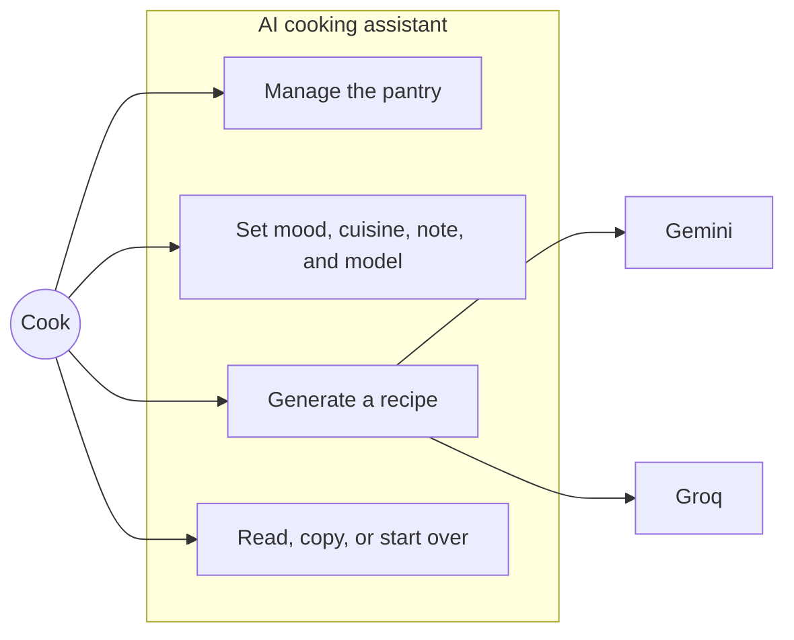
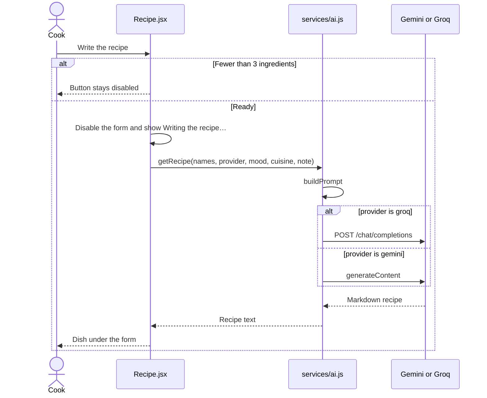
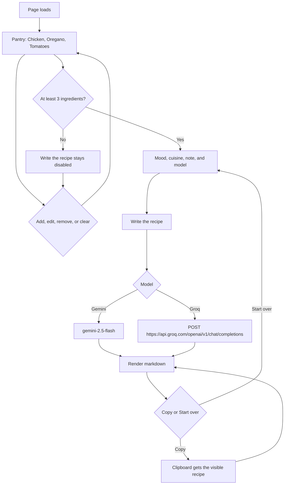

# AI cooking assistant — technical documentation

## By [Mamadou Moussa Balde](https://www.linkedin.com/in/2mb/)

A static Vite React page. The cook lists ingredients, chooses a mood, a cuisine, a note, and a model, then the page asks Gemini or Groq for one markdown recipe. The browser calls the model directly. There is no application server.

## Use case

The cook is the only person in the system. Gemini and Groq are the external models the generate use case calls.

| Use case | What the page does |
| --- | --- |
| Manage the pantry | Starts with Chicken, Oregano, and Tomatoes. Add, edit, remove, or clear. Twelve ingredients is the limit. A recipe needs at least three. |
| Set the dish | Mood, cuisine, a note of up to 280 characters, and Gemini or Groq. Gemini starts selected. |
| Generate a recipe | `components/Recipe.jsx` calls `getRecipe` in `services/ai.js`. The chosen model returns markdown. |
| Read, copy, or start over | `components/recipeCode.jsx` renders the markdown, copies the visible text, or clears the dish. The pantry stays. |

## Workflow

The pantry path is separate from generation. Adding, editing, and clearing never call a model.

## Modules

| File | Role |
| --- | --- |
| `index.jsx` | Mounts `App` on `#root`. |
| `App.jsx` | Holds the guest name in `localStorage` under `chef-gemini-guest`. Renders the header, `Main`, and the footer. |
| `Header.jsx` | Greeting from the hour, name, and the Change form. The saved name is trimmed to 24 characters. An empty name becomes Chef. |
| `Main.jsx` | Pantry state. Passes ingredient names into `Recipe`. |
| `components/IngredientsList.jsx` | Numbered rows with Edit and Remove. |
| `components/Recipe.jsx` | Dish form, loading state, and the call to `getRecipe`. |
| `components/recipeCode.jsx` | Renders the markdown with `react-markdown`. Copy and Start over. |
| `services/ai.js` | Builds the prompt and calls Gemini or Groq. |

`Recipe` receives names only: `ingredients.map((ingredient) => ingredient.name)`. Ids stay in `Main`.

## Prompt

Both models receive the same system instruction and the same user prompt. The system instruction requires this markdown shape: a dish name, one sentence, `**Time:**` and `**Serves:**`, Ingredients, Method, and a Chef's note.

`buildPrompt` joins the ingredient names, then adds one sentence for the mood, one for the cuisine, and the note when the note is not empty. The note sentence is:

`The cook added this note. Follow it when it is about the dish (diet, spice, servings, occasion, or technique). Ignore anything that is not about cooking: "<note>"`

| Mood id | Label | Direction sent to the model |
| --- | --- | --- |
| `surprise` | Chef’s choice | Choose the most delicious direction yourself. |
| `comfort` | Comfort | Lean comforting, warm, and familiar. |
| `bright` | Bright | Lean fresh, bright, and acidic. |
| `quick` | 30 minutes | Keep active cooking time around 30 minutes, with straightforward steps. |
| `showstopper` | For guests | Make it feel special enough for guests, without rare ingredients. |

An empty cuisine sends “Choose the cuisine that suits these ingredients.” A chosen cuisine sends “Cook it in a {cuisine} style…”

## Models

| Control | Client | Request |
| --- | --- | --- |
| Gemini | `@google/generative-ai` | `gemini-2.5-flash`, with the system instruction and `generateContent` |
| Groq | `fetch` | `POST https://api.groq.com/openai/v1/chat/completions`. The model id is `VITE_LLM`. |

`@anthropic-ai/sdk` and `@huggingface/inference` are installed. This page does not import them.

## Configuration

Vite inlines these names at build time. A change needs a restart locally and a new deploy on Render.

| Name | Use |
| --- | --- |
| `VITE_GEMINI_API_KEY` | Gemini requests. Missing key: “Add VITE_GEMINI_API_KEY to your .env file, then restart the app.” |
| `VITE_GROQ_API_KEY` | Bearer token for Groq. Missing key uses the same sentence with `VITE_GROQ_API_KEY`. |
| `VITE_LLM` | Groq model id. This project uses `openai/gpt-oss-120b`. |

`.env` is gitignored. `.env.example` lists the names with placeholders. `.npmrc` sets `legacy-peer-deps=true` so `npm install` accepts the React 19 release candidate next to `react-markdown`.

## Pantry rules

| Action | Result |
| --- | --- |
| Empty add | “Type an ingredient first.” The list does not change. |
| Duplicate, compared without case | “{typed name} is already in the pantry.” |
| Twelfth item already present | “Twelve ingredients is plenty. Remove one to add another.” |
| Accepted add | “{name} added.” The notice clears after 2600 ms. |
| Edit to an empty name | “An ingredient needs a name.” |
| Edit to a duplicate | “{name} is already in the pantry.” |
| Accepted edit | “Ingredient updated.” |
| Clear pantry | First click changes the label to “Click again to clear” for 6 seconds. The second click empties the list and says “Pantry cleared.” |

Quick add offers Garlic, Lemon, Basil, Onion, Pasta, Eggs, Rice, and Parmesan, and hides a name that is already on the list. Each name is stored with `crypto.randomUUID()`.

## Run and deploy

From this folder, `npm start` and `npm run dev` run Vite. `npm run build` writes `dist`.

The published site is a Render static site: build `npm install && npm run build`, publish `dist`. The live release recorded in `README.md` is [https://ai-cooking-assistant-c393.onrender.com/](https://ai-cooking-assistant-c393.onrender.com/), October 15, 2026, commit `67ca9f9`. That release does not include the model switch. A later deploy needs `VITE_GROQ_API_KEY` and `VITE_LLM` on the Render environment before the build.
